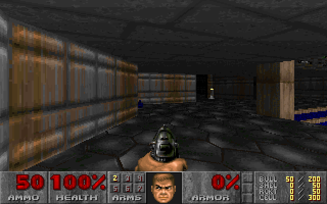

<div align="center">

# ✦ Autonomous DOOM Agent

**A small Python controller that lets AI agents port DOOM to the browser, and only accepts work that locked tests prove.**


</div>

**Autonomous DOOM Agent** ports the supplied doomgeneric engine to WebAssembly using Claude Code agents, so you can play DOOM Episode 1 in a browser. It is different from a plain coding agent because the agents never accept their own work: a plain-Python controller checks which files each agent touched, then runs hash-locked tests in a no-network Docker container. A failed check goes back to the agent as feedback.

<p align="center"></p>
<p align="center"><sub>A real frame captured by the automated test run.</sub></p>

## 🚀 Quick start

Build with the pinned toolchain (Emscripten 4.0.18), then serve and open <http://127.0.0.1:8000/doom/>:

```bash
docker build -t doom-capstone-toolchain .
docker run --rm -v "$PWD":/workspace doom-capstone-toolchain bash build.sh
python3 -m http.server 8000 --bind 127.0.0.1 --directory dist
```

Click the canvas, then use arrows to move, `Ctrl` to fire, `Space` to open doors, `Shift` to run.

## 🧭 How it works

| Step | Who | What happens |
|:-:|---|---|
| 1 | Planner (AI) | Splits the goal into at most 6 small tasks |
| 2 | Coder (AI) | Edits only its own folders, in a fresh git worktree |
| 3 | Controller | Any file outside the role's lane fails the attempt |
| 4 | Controller | Runs locked tests in Docker (no network, read-only) |
| 5 | Controller | Pass: saves a permanent git ref. Fail: retry, max 3 attempts |

Reviewer and tester agents run independently and cannot edit code. Details: [`loop/step5.md`](loop/step5.md).

**Who wrote what.** I designed and built the orchestration, role permissions, recovery and verification policy (`loop/`, loop tests in `tests/`). AI agents wrote the port (`platform/`, `web/`, `build.sh`): every commit authored `loop` in the history is agent work accepted by the controller. The trusted browser tests in `tests/doom/trusted/` were written by a separate QA agent and reviewed by me ([provenance](tests/doom/QA-PROVENANCE.md)).

## ✅ Results

| Run | Outcome | Evidence |
|---|---|---|
| Build from scratch | 5 tasks, 19 agent runs, final gate PASS, 0 open findings | [`report`](artifacts/runs/20261104T174843Z-d39cff/summary.md) · tag `port-complete` |
| Sabotage 1: page loads a missing script | Repaired by agents (one-file fix), final gate PASS | [`report`](artifacts/runs/20261104T185606Z-3582b6/summary.md) · tags `regression-1-injected` → `regression-1-repaired` |
| Sabotage 2: up arrow mapped to backward | Repaired by agents (one-line fix), final gate PASS | [`report`](artifacts/runs/20261104T202813Z-ed0024/summary.md) · tags `regression-2-injected` → `regression-2-repaired` |

Faults were injected by the author. The evidence index is in [`artifacts/README.md`](artifacts/README.md).

## ⚠️ Known issues

- **Agents are not sandboxed.** They run on the host in git worktrees; only verification is containerized. Docker-sandboxing agents clashed with Claude's login.
- **Tests were written by an AI and reviewed by a human.** The QA task ended BLOCKED on a stray `.pyc` file and was recovered by hand. See [`tests/doom/QA-PROVENANCE.md`](tests/doom/QA-PROVENANCE.md).
- **Strictly sequential.** One agent at a time keeps runs auditable but slow.

## 🛠 Run the tests

```bash
python3 -m unittest discover -s tests -p "test_*.py"   # 85 loop tests: state, runner, verifier, controller, coordinator
bash tests/doom/trusted/run.sh final                    # trusted browser gate; run inside the toolchain image
```

The loop entry point is `loop/loop.sh` (controller) and `python3 -m loop.coordinator POLICY.json` (multi-agent run). Agents need the `docker-agent` CLI and a Claude Code login; see [`loop/README.md`](loop/README.md).

## 🙏 Acknowledgments

- Started as a capstone for the **UCLA Bruin Software Engineers (BSE) Loop Engineering Fellowship**. The starter repository supplied the engine, the shareware WAD, platform stubs and the toolchain `Dockerfile`; the original brief is kept in [`docs/original-assignment/`](docs/original-assignment/).
- Engine: [doomgeneric](https://github.com/ozkl/doomgeneric) by ozkl, based on the DOOM source released by id Software (GPLv2). See [`third_party/doomgeneric/README.TXT`](third_party/doomgeneric/README.TXT).
- `assets/doom1.wad` is the DOOM shareware data from id Software, included unmodified.

## License

GPL-2.0, see [`LICENSE`](LICENSE), following the DOOM engine source.
